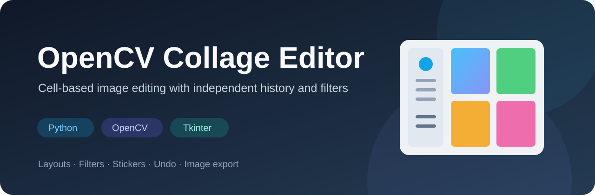
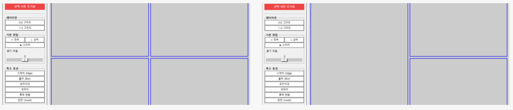
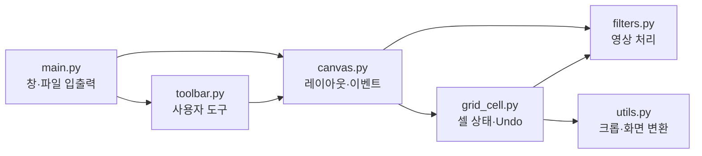

# OpenCV Collage Editor

**여러 사진을 한 화면에 배치하고, 사진마다 필터·밝기·스티커를 적용해 한 장의 이미지로 저장하는 프로그램입니다.**

영상처리 수업의 기말 주제인 콜라주에서 시작했습니다. 사진을 한 장으로 합치기 전에 어떤 편집이 필요한지 알아보려고 기존 편집 도구를 살펴봤습니다. 사진마다 밝기와 필터를 따로 조절할 수 있도록 만들고, 원본과 편집 기록을 사진별로 보관해 한 사진의 변경만 되돌릴 수 있게 했습니다.

**Python · Tkinter · OpenCV · NumPy · Pillow**



## 주요 기능

| 영역 | 구현 내용 |
| :--- | :--- |
| 레이아웃 | `2x2`, `1+2` 셀 배치와 창 크기 변화에 따른 재계산 |
| 기본 편집 | 좌우·상하 반전, 밝기 조절, 원본 초기화 |
| 필터 | Sketch, Blur, Mosaic, Sepia, Grayscale, Invert |
| 스티커 | 클릭 좌표를 셀 내부 좌표로 변환하고 경계를 잘라 Alpha blending |
| 상태 관리 | 사진별로 편집 상태를 최대 15개 보관해 되돌리기 |
| 출력 | 화면 캡처 대신 셀의 OpenCV 데이터를 재조립해 이미지 저장 |

## 구조



| 파일 | 역할 |
| :--- | :--- |
| [`src/main.py`](src/main.py) | 애플리케이션 시작, 이미지 열기·저장, 화면 구성 |
| [`src/canvas.py`](src/canvas.py) | 셀 배치, 클릭·리사이즈 이벤트, 필터와 스티커 적용 |
| [`src/grid_cell.py`](src/grid_cell.py) | 셀별 이미지 상태, 밝기, History Stack과 Undo |
| [`src/toolbar.py`](src/toolbar.py) | 편집 버튼과 밝기 슬라이더 구성 |
| [`src/filters.py`](src/filters.py) | OpenCV·NumPy 기반 필터와 Alpha blending |
| [`src/utils.py`](src/utils.py) | 비율을 유지한 resize/crop, OpenCV→Tkinter 변환 |

[구현 방식과 한계 자세히 보기](docs/implementation.md)

## 실행

Python 3.10 이상을 권장합니다. Tkinter는 일반적인 Windows Python 설치에 포함되어 있습니다.

```bash
python -m venv .venv
.venv\Scripts\activate
pip install -r requirements.txt
python src/main.py
```

스티커 기능을 사용하려면 `stickers/카테고리명/*.png` 형태로 투명 PNG를 추가합니다. 수업 당시 사용한 이미지의 재배포 권한을 확인할 수 없어 공개 저장소에는 포함하지 않았습니다.

## 검증 범위

- 6개 Python 소스의 문법 파싱을 확인했습니다.
- 최종 발표 자료의 레이아웃 화면과 코드 구조가 일치하는지 대조했습니다.
- 현재 환경에는 OpenCV 런타임이 설치되어 있지 않아 이번 공개 정리 과정에서 GUI를 다시 실행하지는 않았습니다.
- 원본 보고서·PPT에는 학번과 수업 자료가 포함되어 있어 공개본에서 제외했습니다.

**문석용 · [GitHub](https://github.com/Moonse01)**

